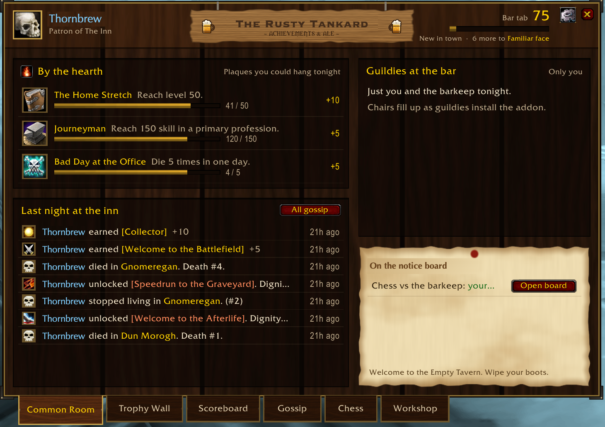

<p align="center"></p>

# The Inn

**The Inn** is a WoW addon for a guild: shared achievements, leaderboards and a feed of what guildmates have been up to, synced in game between everyone who runs it. It targets WoW: Forever (interface 16001) and Classic Era (11509).

<p align="center"></p>

- **Achievements**: about 160, plus custom ones officers can create and grant.
- **Scoreboard**: leaderboards for points, deaths, jumps, PvP, duels and chess.
- **Gossip**: a feed of unlocks, deaths, and duel and chess results.
- **Workshop**: who in the guild has which profession and can craft which recipe.
- **Chess**: play a guildie, or practise against the barkeep.

It only reads game state and never acts for you (see [Staying within Blizzard's rules](#staying-within-blizzards-rules)).

Install, commands and officer tools are in [TheInn/README.md](TheInn/README.md), the user docs that ship with the addon.

## Layout

```
TheInn/              the addon itself (this folder is what goes in Interface/AddOns)
tests/sim.lua        simulated WoW client + guild: timers, roster, addon channel, saved variables
tests/run.lua        test suite, run against both the Forever and Classic Era API flavors
scripts/package.sh   runs the tests, then zips the addon into dist/
scripts/make_textures.py  draws the tavern and achievement-alert art (TheInn/Media/*.tga)
```

## Develop

Needs LuaJIT (WoW runs Lua 5.1): `brew install luajit`.

```sh
luajit tests/run.lua                 # all tests, both flavors
luajit tests/run.lua revoke          # tests whose name contains "revoke"
SIM_VERBOSE=1 luajit tests/run.lua   # show every simulated client's chat output
scripts/package.sh                   # -> dist/TheInn-<version>.zip
python3 scripts/make_textures.py preview.png   # redraw the art (and a PNG preview)
```

The textures are plain math in Python (no image libraries): wood grain from noise, a beveled gold ring, and so on. Edit a shader in the script and rerun it.

To test in game without copying files, symlink the addon into the client's AddOns folder and `/reload` after each change:

```sh
ln -s "$PWD/TheInn" "/Applications/World of Warcraft/_classic_era_/Interface/AddOns/TheInn"
```

## Staying within Blizzard's rules

The addon only reads game state, draws its own UI, and talks over the hidden guild addon channel (plus a guild chat line per unlock, on by default, `/inn announce off` to stop it). The Workshop only reads the profession window while the player has it open. Never automate input or gameplay, and keep the code readable and free (Blizzard's UI Add-On Development Policy).

The `addon only uses approved game APIs` test enforces this on every file in the TOC. It checks code only: comments and text in strings never count.

- **Globals.** Every game global the code reads is on `ALLOWED_GLOBALS` in `tests/run.lua`. The only globals it writes are its own saved variables and slash commands, so it never replaces a game function.
- **Namespace fields.** Allowing `C_TradeSkillUI` would also allow its crafting calls, so each `C_` namespace has its own list of fields in `NAMESPACE_FIELDS`. Code must write `C_Name.Field` out in full: no local holding a namespace, no `C_Name[computed key]`. The test can then see every field it touches. `HOOKED_FIELDS` lists the few action functions the addon only post-hooks to count (abandoned quests, emotes). Those may be hooked or nil-checked, never called.
- **Denylist.** `FORBIDDEN_NAMES` (crafting, casting, using items, opening, expanding or filtering the profession windows, running code from strings) may not appear anywhere in the code, on any object. This is **The Inn's own rule, not a list of what Blizzard bans**. Some of these functions are protected by the client anyway. Others, like `ExpandTradeSkillSubClass`, are fine for addons in general but have no place in one that only reads and shares. `CraftRecipe` stays on it for good.

A new game API is a review step. Add it to the right list with a comment on why the addon needs it, and check that it only reads state or drives The Inn's own UI. The test `API policy catches what it should, and only that` feeds the checker known-good and known-bad snippets; extend it when changing the checker.

The simulator can't prove the live client agrees. Before a release that touches game APIs, sync or the Workshop, run the checklist in [docs/live-client-testing.md](docs/live-client-testing.md) in game.

## Releasing

Bump `## Version:` in `TheInn/TheInn.toc`, add a `**x.y.z**` entry to the changelog in `TheInn/README.md`, commit, then tag:

```sh
git tag v0.4.3 && git push origin main v0.4.3
```

GitHub Actions runs the tests, builds `TheInn-0.4.3.zip` and publishes it as a Release, using the changelog entry as the notes. Every push to `main` runs the tests too. `.pkgmeta` is ready for the CurseForge and Wago packagers if the addon is listed there.
